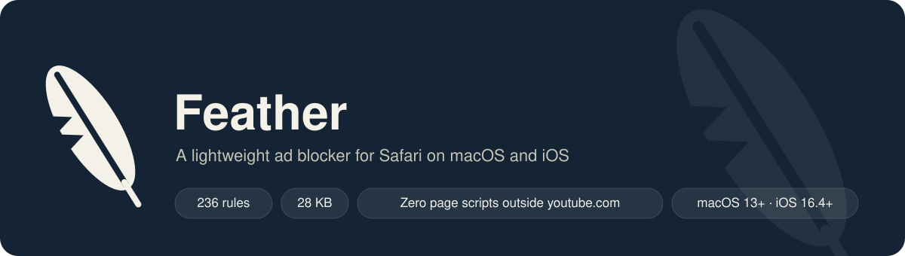
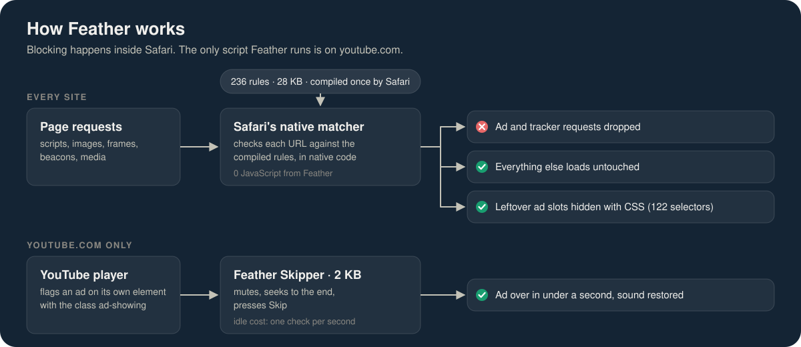
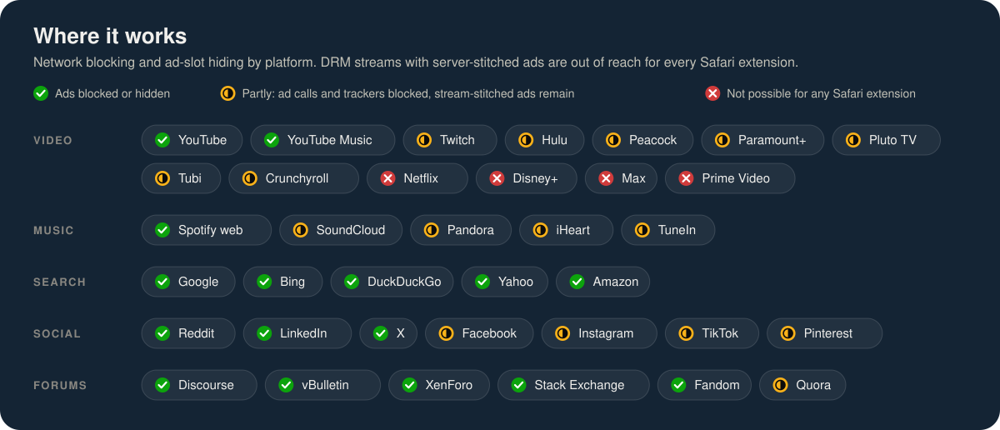
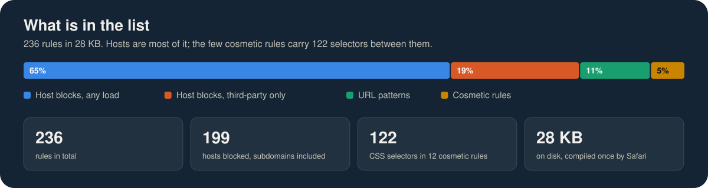

<p align="center">
  
</p>

<p align="center">
  <a href="https://github.com/mokshshah18/feather-the-safari-adblocker/releases/latest"></a>
  <a href="https://github.com/mokshshah18/feather-the-safari-adblocker/actions/workflows/ci.yml"></a>
  
  
  
</p>

Feather is a Safari **content blocker**: a JSON rule list that Safari compiles
into its own bytecode matcher once, when you enable it. After that, Safari does
the blocking itself. No JavaScript from Feather runs on the pages you visit,
nothing is observed, nothing phones home. The whole rule list is 236 rules in
28 KB.

The one exception is YouTube. Its video ads are stitched into the stream and
cannot be blocked by URL, so Feather ships a second, optional extension: a
2 KB script that runs only on youtube.com, waits for the player to say an ad
is showing, mutes it, seeks to its end, and presses Skip.

## Download

Ready-made builds are on the [Releases page](https://github.com/mokshshah18/feather-the-safari-adblocker/releases/latest).
Every release is built from the tagged source by GitHub Actions on a macOS
runner; nothing is uploaded by hand.

### macOS

1. Download `Feather-macOS-<version>.zip`, unzip it, and move **Feather** to
   your Applications folder.
2. Open it once. If the release notes say the build is not notarized, macOS
   will refuse the first launch: go to **System Settings › Privacy & Security**,
   scroll down, and click **Open Anyway**.
3. In Safari, open **Settings › Extensions** and turn on **Feather Blocker**
   and **Feather YouTube Skipper**. Allow the skipper on youtube.com when asked.
4. For a non-notarized build, Safari also needs **Develop › Allow Unsigned
   Extensions** (turn on the Develop menu under Settings › Advanced). That
   toggle resets whenever Safari quits.

Releases become signed and notarized, with none of the steps 2 and 4 friction,
as soon as a Developer ID certificate is added to the repository secrets; the
release workflow explains which ones.

### iOS and iPadOS

Apple does not allow an iPhone to install a downloaded app. Three honest
options:

- **Sideload.** Each release includes `Feather-iOS-<version>-unsigned.ipa`.
  Install it with [AltStore](https://altstore.io) or [Sideloadly](https://sideloadly.io),
  which re-sign it with your own Apple ID. Keep the two app extensions when
  asked; a free Apple ID re-signs every seven days and allows a handful of
  apps.
- **TestFlight.** If the project joins the Apple Developer Program, a public
  TestFlight link will be posted here. That is the route that needs no
  computer at all.
- **Build it yourself** with Xcode and your own team, below.

Whichever route, the last step is the same: **Settings › Apps › Safari ›
Extensions** (Settings › Safari › Extensions on iOS 17 and earlier), turn on
**Feather Blocker** and **Feather YouTube Skipper**, and allow the skipper on
youtube.com.

## How it works

<p align="center">
  
</p>

Safari reads the rule list once, when you enable the blocker, and compiles it
into its own matcher. From then on every request on every site is checked in
native code before it leaves the browser. Feather has no background process,
no page scripts, and no network access of its own. The Skipper is the single
exception, and it only exists because YouTube's video ads come from the same
servers as the video and cannot be told apart by URL.

## Build from source

Requirements: Xcode 15 or later. macOS 13+ to run the Mac app, iOS 16.4+ for
the iPhone/iPad app (any device that runs the current Safari qualifies).
`make package` on a Mac produces the same zip the release workflow does.

### macOS

1. Open `Feather.xcodeproj`, pick the **Feather (macOS)** scheme, press Run.
   The project is set to "Sign to Run Locally", so no Apple ID is needed.
2. In Safari, open **Settings › Extensions** and turn on **Feather Blocker**
   and **Feather YouTube Skipper**. Allow the skipper on youtube.com when asked.
3. Locally signed extensions need one more switch: Safari **Develop › Allow
   Unsigned Extensions** (enable the Develop menu under Settings › Advanced).
   Pick a team under Signing & Capabilities instead if you want to skip this.

### iOS and iPadOS

1. Open `Feather.xcodeproj`, select the three **(iOS)** targets one at a time
   and choose your Team under Signing & Capabilities. Apple requires a team for
   any iOS build, free accounts included.
2. Pick the **Feather (iOS)** scheme, choose your device, press Run.
3. On the device, go to **Settings › Apps › Safari › Extensions** (Settings ›
   Safari › Extensions on iOS 17 and earlier) and turn on **Feather Blocker**
   and **Feather YouTube Skipper**. Allow the skipper for youtube.com.

The app's only job is to host the extensions. Its window shows whether each one
is on, how many rules are loaded, and has a Reload button for after you edit
the rules.

## What it blocks

<p align="center">
  
</p>

| Where | What happens | What it cannot do |
|---|---|---|
| Everywhere | Requests to 199 ad exchanges, trackers, measurement beacons and session recorders are dropped. AdSense, Google Publisher Tag, Taboola, Outbrain, Prebid and the common `ad-*` containers are hidden. | Ads served from a site's own domain under non-ad-looking paths. |
| Google Search, Bing, DuckDuckGo, Yahoo | Sponsored results and shopping units hidden. Google's ad-click and conversion beacons blocked. | Nothing known. |
| YouTube, YouTube Music | Display ads, masthead, promoted videos, companion ads, premium upsells hidden; tracking endpoints blocked; in-stream video ads skipped by the Skipper extension. | YouTube can detect blocked ad requests and show its "ad blockers violate the Terms" dialog. If that happens, turn the content blocker off for youtube.com and keep the Skipper, which does not trigger it. |
| Spotify web player | Ad decision and ad event endpoints blocked; you get silence or a skip instead of an ad. | The Spotify desktop and mobile apps are not Safari and are untouched. |
| SoundCloud, Pandora, iHeart, TuneIn, other radio | Promoted tracks, Pandora ad servers, and the AdsWizz and Triton audio ad networks blocked. | Audio stitched into the stream by the service itself. |
| Twitch | Ad decisioning (`edge.ads.twitch.tv`), Amazon ad system and telemetry blocked. | Pre-roll and mid-roll video is spliced into the HLS stream by Twitch's servers and no content blocker can remove it. |
| Hulu, Peacock, Paramount+, Pluto, Tubi, Crunchyroll | FreeWheel, Innovid, SpringServe, SpotX and the other third-party ad decisioning used by these players is blocked, plus Hulu's own ad servers. | Ads stitched server-side still play. On some services a blocked ad slot shows as a black screen for the ad's length instead. |
| Netflix, Disney+, Max, Prime Video ad tiers | Nothing. | DRM-protected, server-stitched streams. No Safari extension of any kind can remove these ads. |
| Reddit | Promoted posts, comment-page ads, sidebar ads hidden on new and old Reddit; Reddit's ad and event pixels blocked. | Nothing known. |
| LinkedIn, X | Right-rail ads and promoted posts hidden; Insight Tag and ad tracking blocked. | Nothing known. |
| Facebook, Instagram | Their tracking pixels are blocked on every other site. | Sponsored posts on facebook.com and instagram.com use randomized markup that a static rule cannot target. |
| Amazon | Sponsored results and detail-page ad units hidden; telemetry pixels blocked. | Nothing known. |
| Forums | Ad slots of the Discourse ad plugin, vBulletin, XenForo (Siropu Ads Manager), Stack Exchange and Fandom hidden. Generic AdSense, GPT and native-ad units everywhere. | Hand-placed banners with site-specific markup. |

If a site misbehaves, long-press Safari's reload button and choose **Reload
Without Content Blockers**. Then open an issue with the URL and the rule can be
narrowed.

## Why it is light

<p align="center">
  
</p>

| Approach | Cost per page |
|---|---|
| Content blocker (Feather Blocker) | Zero. Safari matches URLs in native code against a precompiled trie. |
| Content script (Feather Skipper) | Runs only on youtube.com. Idle cost is one DOM query per second; during an ad it checks four times a second for the Skip button, then stops. |
| Typical browser-extension blocker | A background process intercepts every request on every site with JavaScript rules, and injects scripts into every page. |

The rule list stays small on purpose. EasyList alone is 70,000 rules; Feather's
236 cover the networks that serve nearly all ads and the platforms named above.
Safari's limit is 150,000 rules per blocker, so there is room to grow.

## Editing the rules

Rules are written in three plain-text files and compiled to JSON:

| File | Contents |
|---|---|
| `rules/domains.txt` | Hosts to block. A `[block]` section for pure ad hosts and a `[block-third-party]` section for vendors whose own website you might visit. |
| `rules/urls.txt` | Regex rules with optional `load-type`, `resource-type`, `if-domain` and `unless-domain` options. Prefix `@@` for an exception. |
| `rules/cosmetic.txt` | `domain##selector` lines that hide elements. `##selector` alone applies everywhere. Aliases like `$google` expand to a domain list. |

```bash
make rules
```

compiles them into `ContentBlocker/blockerList.json`, and

```bash
make test
```

checks the JSON against Safari's format and WebKit's regex subset, then runs
110 URL cases (ad URLs that must be blocked, playback and API URLs that must
not) and a headless-browser test of the YouTube skipper. The browser test needs
Node and Playwright. After editing, build again and press **Reload Rules** in
the app, or toggle the blocker off and on in Safari.

Regex rules must stay inside what WebKit's content-blocker compiler accepts:
`.` `*` `+` `?`, character classes, groups, `^` and `$`, and `\.` escapes. No
alternation, no `{n,m}`, no `\d`. The test catches these.

## Project layout

```
App/              SwiftUI container app, shared by macOS and iOS
ContentBlocker/   Content blocker extension (handler, Info.plist, blockerList.json)
Skipper/          Web extension: manifest.json and youtube.js
rules/            Human-readable rule sources
docs/             The figures in this README, generated SVG
tools/            build_rules.py, test_rules.py, test_skipper.mjs,
                  gen_icons.py, gen_diagrams.py, gen_project.rb
Feather.xcodeproj Generated by tools/gen_project.rb; run `make project` after changing it
```

The Xcode project is generated, not hand-maintained. Add files or change build
settings in `tools/gen_project.rb` and run `make project` (needs
`gem install xcodeproj`). The README figures are generated too: `make diagrams`
redraws them from the compiled rule list, so the counts in the pictures always
match what ships.

## Releasing

CI (`.github/workflows/ci.yml`) runs the rule and skipper tests on Linux and an
unsigned Xcode build of both platforms on every push and pull request. To cut a
release, tag the commit and push the tag:

```bash
git tag v1.0.1
```

```bash
git push origin v1.0.1
```

The release workflow builds the macOS app, the unsigned iOS `.ipa`, and the
standalone rule list on a macOS runner and attaches them to a GitHub Release
named after the tag. With `MACOS_CERTIFICATE_P12`, `MACOS_CERTIFICATE_PASSWORD`,
`APPLE_TEAM_ID`, `APPLE_ID` and `APPLE_APP_PASSWORD` set as repository secrets,
the macOS build is signed with Developer ID and notarized; without them it is
ad-hoc signed and the release notes say so. Run the workflow by hand from the
Actions tab to get the same files as a build artifact without publishing.

## License

MIT. See `LICENSE`.
